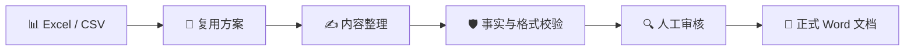

<h1> SheetWeaveAgent</h1>

### 让业务数据，成为可以交付的正式文档。

**Excel 里的业务记录，Word 里的企业规范，一条可审核的生成流程。**

SheetWeaveAgent 面向需要反复编写正式报告的团队，将表格解析、模型整理、事实校验与企业模板排版串成完整工作流。从部门进展到项目交付，从模型评估到整改跟踪，把时间留给判断与决策，把重复整理交给工具。

**Python 3.11+ · Flask · SQLite 任务队列 · OpenAI-compatible LLM · OOXML**

[📽️ 项目展示](assets/showcase/SheetWeaveAgent-项目展示.pdf) · [🖥️ 完整页面与成果](assets/showcase/SheetWeaveAgent-完整页面存档.pdf) · [🚀 使用指南](docs/operations.md) · [🧠 架构与设计](docs/project-design.md)

## ⏱️ 从 20 分钟，到 2 分钟内

一份报告的成本，往往藏在生成之前和之后：从表格挑出有效进展，把多行内容归入正确目录，整理措辞、调整编号，再逐项核对数字和格式。下一个周期，这些工作又来一遍。

> **部门实际使用反馈：过去编写一份符合规则的文档并完成人工对比，约需 20 分钟；熟练使用 SheetWeaveAgent 后，2 分钟内即可完成，耗时降低约 90%，处理效率提升至原来的约 10 倍。**

效率提升来自整条流程：**方案一次确认、后续重复使用；内容集中审核、格式自动落实。** 以上为部门特定场景的使用反馈，首次适配与模型等待时间随实际任务而变化。

## 🎯 一套工作流，覆盖多种文档交付

| 业务场景 | 输入材料 | 交付结果 |
|---|---|---|
| 📋 部门进展汇总 | 项目台账、状态、周期进展 | 按业务目录组织的进展报告 |
| 📦 项目阶段交付 | 实施记录、验收项、遗留问题 | 阶段交付报告 |
| 📊 模型效果评估 | 实验记录、效果指标、资源数据 | 模型评估报告 |
| 🔎 问题整改跟踪 | 问题清单、整改措施、验证记录 | 整改跟踪报告 |

场景变化，复用同一套“字段 → 目录 → 正文 → 格式”的方案机制。[data/](data/) 提供分类输入、方案与输出资料，便于直接查看不同场景的组织方式。

## ✨ 从“生成一段文字”到“交付一份文档”

| 能力 | 用户得到什么 |
|---|---|
| 🧩 **智能方案适配** | 模型辅助识别表格字段与参考模板，人工核对后保存。支持多字段正文、多行归组和固定目录 |
| ✍️ **两种内容策略** | 原文保留执行本地规范化；规范润色允许重新分条、组织层级，并接受额外要求 |
| 🛡️ **事实保护与回退** | 检查数字、日期、版本和状态等关键事实，冲突候选保留供审核，默认回退至原文路径 |
| 🔍 **三栏联动审核** | 来源、当前内容、文档预览同步定位；模型候选、行内 Diff 与人工修改清晰可见 |
| 📄 **可继续编辑的 Word** | 原生标题大纲、多级列表与企业样式，生成后执行 OOXML 格式检查，支持可选 PDF 预览 |
| ⚙️ **独立后台执行** | 持久化任务队列、受控并发和状态查询，让长时间模型调用与 Web 接待分离 |



## 🧠 为什么值得做成独立产品？

直接使用 Codex，适合探索材料和完成定制任务。面向团队的高频文档工作，还需要把每次对话中的约定沉淀下来：**谁都能操作、规则可以复用、结果能够核查、文档保持一致。**

SheetWeaveAgent 将这些要求做成日常入口：

- **把提示词变成方案**：字段、目录、筛选和格式长期保存，减少重复解释。
- **把结果变成可审核交付物**：来源引用、候选、Diff 与版本记录贯穿流程。
- **把格式要求变成程序验收**：模型负责语义整理，确定性代码负责文档结构与排版。
- **把个人操作变成共享流程**：业务人员通过网页完成任务，后台统一排队、限并发、记录状态。

项目的技术价值，在于把 LLM 接入业务交付链路：**用 Harness 协调模型、规则、验证与人工决策，让生成能力成为可复用的产品能力。**

## 🚀 快速体验

在项目根目录执行，使用 Python 3.11+：

```bash
conda activate py31115
python -m pip install -r requirements.txt
test -f .env || cp .env.example .env
chmod 600 .env
python -m sheetweave_agent.server --host 127.0.0.1 --port 18989
```

打开 `http://127.0.0.1:18989`，按 **方案适配 → 新建文档 → 审核 → 下载** 完成首次交付。

模型辅助适配与规范润色需在 `.env` 配置已获授权的 API；已有方案可使用原文模式在本地生成。首次部署请创建方案或迁移既有方案库，`data/` 中的 JSON 为规则参考与导出资料。

## 🧪 工程验证

回归测试覆盖解析、方案、事实保护、任务队列、审核版本及 DOCX 格式，自动化测试无需外部 LLM。

```bash
python -m pytest
ruff check .
ruff format --check .
```

## 📚 继续了解

- [使用指南](docs/operations.md)：部署、模型配置、方案管理与故障排查。
- [架构与设计](docs/project-design.md)：业务建模、IR、Harness、后台执行与文档渲染。
- [项目展示 PDF](assets/showcase/SheetWeaveAgent-项目展示.pdf)：快速了解产品流程与关键界面。

适用范围、模板兼容性与数据管理注意事项见使用指南。仓库跨场景验证资料及展示统计用于说明功能，不作为客户规模或经营成果指标。
