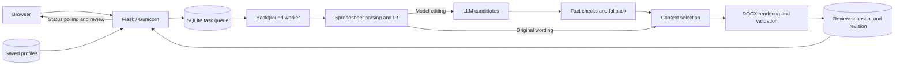

# SheetWeaveAgent Architecture and Design

[简体中文](project-design.md) · **English** · [Project overview](../README.en.md) · [User guide](operations.en.md)

## 1. From records to deliverables

A formal document must use the correct data, preserve business facts, and follow the organization's formatting rules. During manual preparation, these responsibilities overlap: the same person extracts rows, rewrites them, moves text into sections, and checks the final Word file. The system separates reusable decisions about fields and format from each run's data scope and final editorial decisions.

| Scenario | Relationship to preserve | Design implication |
|---|---|---|
| Department progress | Period determines the body column, project determines the section | Separate fixed fields from changing weekly columns |
| Milestone delivery | Implementation, acceptance checks, and open issues form one deliverable | Combine fields and group related rows |
| Model evaluation | Results belong to specific settings, versions, and limitations | Protect metrics and versions while retaining evaluation boundaries |
| Remediation tracking | Issue, action, evidence, and status remain linked | Preserve source references and enforce filters |

## 2. Adaptation, generation, and review

### Profile adaptation

Local inspection reads spreadsheet headers and reference DOCX style evidence. The model can propose field semantics, section structure, and formatting. The user checks the suggested rules and validates a sample before saving a version. The saved profile defines both an input contract (field mapping and row selection) and an output contract (headings, paragraphs, and numbering).

### Generation

A submission selects a profile, file, worksheet, and optional period. The task freezes the chosen rules and template. Rows can be grouped under a common heading into a single content block, which becomes the unit of semantic editing and review. The system retains references back to each contributing row.

### Review

The source, candidate, and adopted text remain distinguishable. Linked highlighting locates the same block across the source, editor, and preview panes. Inline diffs help identify textual changes. Manual edits start from the current text, and revisions protect recent changes from stale submissions. Candidates with significant fact conflicts remain visible and selectable after review. The default output follows the original-text path for affected blocks.

## 3. Execution architecture

The worker claims jobs atomically and renews its lease. Web threads can return after accepting a job and handle other short requests while the model runs. A waiting model call still holds a background task slot. Job concurrency and per-report batch concurrency bound different layers of the upstream load.

Cancellation and publication checks help guard against stale results. Job state and file snapshots are persisted separately. If publication is interrupted, revisions help verify which result was published. An expired lease does not trigger an unconditional replay of potentially billable LLM calls.

## 4. Intermediate representation (IR)

| Model | Carries | Why it matters |
|---|---|---|
| `SourceFile` / `SourceRecord` | File, worksheet, physical row, raw values, and mapped fields | Trace report content back to inputs and account for filtered records |
| `PreparedReport` / `ContentBlock` | Section text, source references, candidates, edits, and validation state | Organize multiple input rows as one auditable unit |
| `ReportPlan` / `ReportParagraph` | Final section hierarchy and paragraph roles | Give HTML and DOCX a shared structural plan |

The normalization dictionary `TERM_REPLACEMENTS` standardizes terminology. Source references provide the evidence for reviewing facts. Keeping term normalization, row filtering, model editing, and rendering distinct helps explain how a sentence changed.

## 5. LLM harness

| Stage | Deterministic responsibility | Model contribution |
|---|---|---|
| Adapt | Inspect inputs and validate proposed rules | Suggest mappings, headings, and styles |
| Prepare | Select editable blocks, preserve IDs, and assemble context and protected facts | Rewrite the permitted body text and return structured blocks |
| Verify | Decode the response and compare key source facts | Optionally attempt a targeted correction |
| Render | Build and validate headings, lists, paragraph formatting, and OOXML | |
| Review | Preserve candidates, selection state, and revisions | Suggest content for human review |

Fact checks focus on dates, percentages, quantities, metrics, versions, and statuses. Polishing allows reorganization and changes in wording. Some term differences or numbers without units are advisory. These checks are heuristics with limited coverage of implied meaning, attribution, and subtle changes in conclusions.

Invalid JSON, missing block IDs, and invalid paragraph hierarchy are response-structure failures. Valid structure with conflicting facts produces reviewable warnings and may trigger fallback. Transport timeout can fail the whole task before a document is available.

## 6. Word rendering

Python ZIP/XML utilities write the OOXML package. The profile controls typography, spacing, hierarchy, and numbering. Native Word heading styles support outline navigation. Three-level native lists support continued editing, with list instances scoped to limit unwanted renumbering across sections. Supported embedded spreadsheet images retain their source-row association.

HTML is used for reviewing content structure and Word or PDF for final pagination. PDF conversion relies on LibreOffice and installed fonts. Complex layouts such as text boxes and dense tables may require separate adaptation.

## 7. Product and engineering trade-offs

The product turns a recurring document request into a reusable profile and a review workflow. Team members can reuse the same mappings and layout, inspect source rows and candidates, and export a consistent editable file. A general-purpose coding agent remains useful when investigating a new layout or extending what the product can handle.

| Area | Main code |
|---|---|
| Spreadsheet input | `src/input_parser.py`, `src/csv_parser.py` |
| Adaptation and profiles | `src/adaptation.py`, `src/profiles.py`, `src/web_profiles.py` |
| IR and normalization | `src/models.py`, `src/content_builder.py`, `src/planner.py`, `src/normalizer.py` |
| Model and generation harness | `src/llm/`, `src/service.py` |
| Word and PDF | `src/docx_renderer.py`, `src/word_lists.py`, `src/validator.py`, `src/pdf_preview.py` |
| Background execution and review | `src/task_queue.py`, `src/task_worker.py`, `src/server.py`, `src/web_sessions.py` |
| Statistics and timing | `src/stats.py`, `src/timing.py` |

Packaging exposes `src/` as the `sheetweave_agent` import package. Useful measures for future improvements include review edits, fact warnings, operator time, and generation success rate.
