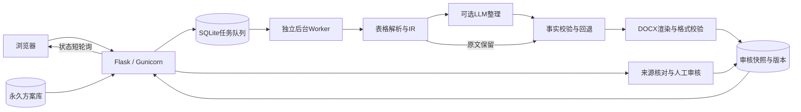

<h1> SheetWeaveAgent 架构与设计</h1>

### 从结构化业务数据，到可审核的文档交付。

本文解释业务建模、实现原理与工程取舍。项目入口及价值概览见 [README](../README.md)，运行步骤与配置见 [使用指南](operations.md)。

## 1. 产品切入点：补齐数据到交付之间的一公里

一份正式报告通常需要同时满足三类要求：内容来自正确的数据范围；数字、版本和状态没有在整理中失真；标题、目录和正文格式符合组织规范。

人工流程容易把这些责任揉在一起：一边复制Excel，一边判断事项归属，一边改写句子和调整Word格式，最后逐行回查。短期可以依赖熟练人员，持续执行则会遇到规则重复解释、格式漂移、漏项和审核成本问题。

项目将这些责任拆成“方案定义、当次生成、版本审核”三个阶段。可复用部分进入方案，周期和文件范围留在当次任务，最终采用什么内容由审核状态决定。

产品的效率收益来自三处：方案复用减少重复配置，语义整理减少人工重写，联动审核减少跨文件查找。衡量这些收益时，可分别记录首次适配成本、日常操作时间与模型等待时间，定位下一步最值得优化的环节。

## 2. 场景建模：把业务差异变成可配置规则

场景不同，文档组织方式也不同。通用化的关键是定义可变规则，而不是只更换报告名称。

| 场景 | 需要表达的业务关系 | 对实现提出的要求 |
|---|---|---|
| 部门进展 | 周期列对应本次正文，项目/事项决定目录 | 区分固定字段与动态周次，保留状态策略 |
| 阶段交付 | 实施、验证、遗留问题和后续措施共同构成交付项 | 多字段组成正文，同主题多行合并，避免遗漏风险 |
| 模型评估 | 实验条件、已有指标与限制必须正确归属 | 保护数值和版本，保留评估边界，不代算或外推结论 |
| 问题整改 | 问题、措施、证据和状态共同支持闭环 | 来源追溯、条件筛选及人工确认，不能把“待确认”润色成“完成” |

`data/` 将公开参考与跨场景验证资料按类别组织，覆盖从输入、方案到输出的完整链路，方便复现与扩展。

## 3. 产品闭环：适配、生成、审核

### 方案适配：把约定固化下来

输入样例和参考DOCX经本地结构检查，必要时请求模型提出字段、目录及格式建议。用户核对主要正文、补充字段、筛选条件与样式，经试生成后保存版本。

方案同时表达输入契约和输出契约：前者说明哪一列是什么意思、哪些行进入哪一目录；后者说明标题、段落与编号如何呈现。模型建议不是已验证规则，保存前需要人工确认。

### 当次生成：复用规则，改变数据范围

任务选择方案、文件、工作表和适用周期，冻结规则及模板后进入队列。方案更新不应悄悄改变已提交任务的语义。

解析后的多行记录可以聚合成一个正文区块，也可以分别属于不同目录。区块是模型整理和人工审核的单位，不要求“一行Excel对应一段Word”。

### 审核确认：区分候选与已采用内容

来源、模型候选、人工修改和当前采用版本各自保留。三栏分别承担证据、内容决策和输出效果的职责；联动高亮帮助定位，Diff帮助识别修改，revision保护防止旧页面覆盖新结果。

模型候选存在并不意味着已经用于导出。严重冲突默认回到原文路径，用户仍可核对后谨慎采用；人工编辑确认后直接生效，不再冒充由自动事实检查背书。

## 4. 执行架构：隔离长任务，保持交互响应

队列持久化任务状态，Worker原子领取并周期续租。Web返回提交结果后可接待其他请求，不必在整个模型推理期间占用提交线程。取消和发布保护降低过时任务覆盖当前结果的风险；故障租约失效后不会盲目重放可能计费的模型调用。

模型等待期间，后台执行线程保留任务名额，CPU通常较空闲；Web可以继续响应提交、查询与下载。任务并发与批次并发分别控制，实现交互响应与上游负载之间的平衡。

恢复与一致性以持久化状态、租约和版本为依据。文件快照与任务状态分别落盘，发布中断后需核对版本；外部模型调用按可能已经执行处理，避免故障恢复时重复计费。

## 5. IR：让结构、语义与来源保持关联

统一中间表示不是一个术语词表，而是一组贯穿流程的数据模型：

| 对象 | 表达什么 | 为什么保留 |
|---|---|---|
| `SourceFile` / `SourceRecord` | 文件、工作表、物理行、原始值与映射字段 | 回到输入核实内容，并保留排除记录的可追溯信息 |
| `PreparedReport` / `ContentBlock` | 目录内正文区块、来源引用、候选、编辑及校验状态 | 将语义整理与物理表格解耦，多行仍可定位来源 |
| `ReportPlan` / `ReportParagraph` | 最终目录与段落角色 | 让HTML展示与DOCX渲染使用明确的结构计划 |

术语表 `TERM_REPLACEMENTS` 属于规范化层，用于统一常见表达；它不是事实数据库，也不能替代来源证据。周期选择、行筛选、术语归一和模型改写应在不同职责下执行，避免无法解释内容变化的原因。

## 6. Harness：把模型能力编排进可控流程

Harness贯穿适配、整理、校验、渲染和审核五个环节：它决定模型处理什么、结果如何验收，以及失败时如何保留证据和恢复可用内容。当前通过服务编排与验证模块实现，保持职责清晰、调用路径可追踪。

| 阶段 | 确定性职责 | 模型参与范围 |
|---|---|---|
| 适配 | 读取表头、模板样式证据，验证建议规则 | 提议字段语义、目录与格式，最多有限轮修正 |
| 整理 | 按方案提取区块，组织只读上下文和保护事实 | 改写指定正文，返回稳定区块ID和合法段落结构 |
| 校验 | 解析结构，对比关键事实及提示性差异 | 可选对冲突作定向修正，不自行决定绕过校验 |
| 渲染 | 生成标题、段落、编号及OOXML属性并验收 | 不直接自由编写整个Word包 |
| 审核 | 保存候选与选择状态，追踪revision | 候选供用户判断，最终确认由用户完成 |

日期、百分比、指标、明确数量、模型版本和状态是事实保护的重点。规范润色允许重组分段、顺序和表达，术语提及或部分无单位数字差异可作为提示，不按逐字相同验收。规则不等于完整语义理解，不能自动识别所有误归属、隐含条件变化或错误结论。

结构失败与事实失败需区分：无效JSON、区块缺失或非法层级会在响应解析阶段报错；合法结构中的事实冲突按校验结果保留候选并回退。网络超时使任务失败，不等于生成了可下载的完整报告。

## 7. 文档工程：交付可以继续工作的 Word

渲染使用Python标准库ZIP/XML处理OOXML，由方案控制字体、字号、行距和标题层级。标题具备Word大纲语义，正文使用原生三级列表；不同目录的编号定义和实例隔离，降低修改一个列表影响其他段落的风险。

模板样式继承、编号规则和最终格式均由代码检查，而不是要求模型“尽量像模板”。HTML呈现可读结构，Word/PDF负责最终分页；字体环境和LibreOffice兼容性仍会影响版式，复杂表格与文本框不属于任意保真的承诺。

## 8. 产品差异：把通用能力沉淀为团队工作流

通用编程Agent擅长探索材料、编写脚本和处理定制需求。专用产品进一步将这些能力组织成稳定的业务入口，让每次任务积累的规则可以持续复用。两者的比较，可以落在日常使用的具体成本上：

| 维度 | 直接交给通用编程Agent的一次性任务 | SheetWeaveAgent固化的工作流 |
|---|---|---|
| 需求表达 | 通过对话提供材料、格式及当次要求 | 复用已确认的输入与输出契约 |
| 执行方式 | 根据任务选择或编写处理办法 | 在已实现的解析、校验、渲染路径内执行 |
| 面向使用者 | 需要参与任务表达、结果核对及必要的工具操作 | 以表单、候选选择和来源审核服务重复业务 |
| 可追溯产物 | 取决于当次任务是否建立相关记录 | 原始行引用、候选、Diff和revision为内置机制 |
| 多人运行 | 需要另行建设共享任务管理 | 已提供队列、共享方案、受控并发与状态查询 |

专用系统把格式、事实保护和审核机制从个人提示词习惯转为共享流程，减少“每次从头解释”的成本。遇到尚未支持的布局或复杂文档，通用Agent仍适合辅助扩展实现；两者可以协作，而不是相互替代。

## 9. 工程地图与演进方向

| 路径 | 职责 |
|---|---|
| `src/input_parser.py`、`csv_parser.py` | 输入、工作表、周期与字段解析 |
| `src/adaptation.py`、`profiles.py`、`web_profiles.py` | 方案建议、版本库及适配交互 |
| `src/models.py`、`content_builder.py`、`planner.py` | 来源、区块、目录和最终段落计划 |
| `src/normalizer.py`、`numbering.py` | 术语、标点和编号规范化 |
| `src/llm/`、`service.py` | 模型配置、请求、结构与事实校验、生成服务 |
| `src/docx_renderer.py`、`word_lists.py`、`validator.py` | OOXML、原生列表与格式验收 |
| `src/task_queue.py`、`task_worker.py`、`server.py` | 后台队列、执行与统一启动 |
| `src/web.py`、`web_sessions.py`、`pdf_preview.py` | Web、审核版本及PDF转换 |
| `src/stats.py`、`timing.py` | 聚合统计与脱敏阶段诊断 |
| `tests/`、`data/`、`assets/showcase/` | 回归证据、分类资料与展示PDF |

源码物理上直接位于 `src/`，通过打包配置映射为 `sheetweave_agent`，并不存在必须另找的 `src/sheetweave_agent/` 目录。

后续演进可沿三条主线推进：扩大输入与模板覆盖，提高复杂正文的语义组织质量，完善审核效率与运行可观测性。以人工改动量、事实告警、操作耗时和生成成功率持续评估，让模型能力的提升转化为用户可感知的交付质量。
