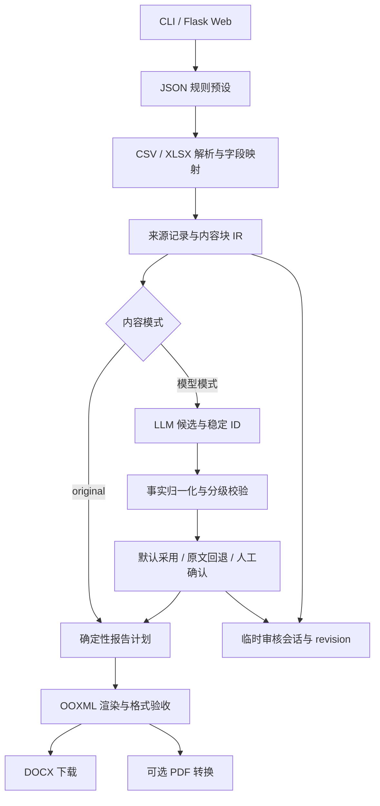

# docAgent 项目介绍

更新日期：2026-10-12。本文说明当前实际代码结构与实现方式；安装、配置和部署命令见 [README](../README.md)，里程碑与待开发范围见 [ROADMAP](../ROADMAP.md)。

## 1. 项目定位

周报生成 Agent 是公司内部周报整理工具。它读取 CSV/XLSX，选择已知规则、工作表和周次，建立可追溯内容，提供可选 LLM 整理与人工审核，再通过确定性 OOXML 引擎生成 DOCX。

`rd3` 处理两行表头、多周列的研发三部格式，章节默认从 9 开始；`general` 处理单行表头记录，组织“本周工作 / 问题与风险 / 下周计划”，章节默认从 1 开始。未知表格或任意复杂模板自动适配尚未实现。

## 2. 目录与文件

### 根目录

| 路径 | 用途与管理方式 |
|---|---|
| `src/` | 全部应用模块和随包分发的资源，直接放置业务代码 |
| `tests/` | pytest 单元、集成、Web 和端到端回归，LLM 使用 Mock |
| `data/周报.csv` | 原始两行表头参考输入，不修改 |
| `data/研发三部周报模板.docx` | OOXML 模板与格式参考夹具，不修改 |
| `docs/project-overview.md` | 当前项目结构、架构和原理介绍 |
| `docs/wsl-lan-access.md` | WSL 局域网访问与 Windows 转发维护，Linux 原生部署无需照搬 |
| `var/` | 持久化运行数据，整体排除 Git，保留并备份 |
| `outputs/` | CLI 按需创建的报告目录，整体排除 Git；清理前区分用户报告和临时样例 |
| `gunicorn.conf.py` | 项目级部署配置，独立于应用源码；定义线程 Worker、线程数和超时，在项目根目录启动时自动加载 |
| `pyproject.toml` | Python 版本、运行依赖、setuptools 映射、命令入口、pytest/Ruff 配置 |
| `requirements.txt` | `-e .` 安装项目，加固定版本 pytest 和 Ruff |
| `.env.example` | 服务端配置示例，可提交；不含真实密钥 |
| `.env` | 用户本地密钥与配置，不提交，应用不自动加载，不随整理覆盖 |
| `.gitignore` | 排除运行数据、输出、密钥、缓存及构建产物 |
| `AGENTS.md` | 仓库开发、数据保护、测试和提交约定 |
| `README.md` | 安装、CLI/Web 使用、共享部署、配置和验证 |
| `ROADMAP.md` | 当前里程碑、设计边界和后续开发原则 |
| `weekly_report_agent.egg-info/` | 安装时在根目录生成的包元数据，不是源码，忽略 Git |
| `build/`、`dist/` | 打包时可能生成的产物，忽略 Git，可重新生成 |
| `__pycache__/`、`.pytest_cache/`、`.ruff_cache/` | 运行或检查生成的缓存，忽略 Git，可重新生成 |

`scripts/` 是未来维护脚本的约定位置，当前没有需要保留的开发脚本，不为目录树创建空目录。`.git/` 属于 Git；环境提供的隐藏工具目录不属于业务源码，不擅自清理。

### 应用模块

| 文件 | 职责 |
|---|---|
| `src/__init__.py` | Python 逻辑包的初始化 |
| `src/__main__.py` | `python -m weekly_report_agent` 的执行入口，调用 CLI |
| `src/cli.py` | 解析输入、模板、周次、日期、模式和外发确认等参数 |
| `src/web.py` | Flask 应用工厂与上传、预览、审核、PDF、下载、帮助和示例路由 |
| `src/service.py` | 组织完整流水线，以及人工编辑、版本采用、计划生成和渲染校验 |
| `src/input_parser.py` | CSV/XLSX 读取、Sheet/周次选择、字段映射、原物理行位置和输入告警 |
| `src/csv_parser.py` | 旧 CSV 接口及多行表头/周次辅助逻辑，仍被调用，不能按旧模块名称删除 |
| `src/models.py` | 来源记录、内容块、解析结果、准备报告、段落与报告计划的数据模型 |
| `src/content_builder.py` | 按章节与项目/来源行分组，产生内容块与双向来源关系 |
| `src/normalizer.py` | 术语、正式称呼、相对星期与基础标点规范化 |
| `src/planner.py` | 生成报告段落树、标题和正文编号，调用文字规范化 |
| `src/docx_renderer.py` | 复制 DOCX ZIP 部件，替换 document.xml，确定性写入段落属性 |
| `src/docx_security.py` | DOCX ZIP 路径、重复条目、CRC、解压体积、压缩比、必要部件及 XML 检查 |
| `src/validator.py` | 输出编号、文字、字体、字号、缩进、间距、页面设置和包结构验收 |
| `src/web_sessions.py` | 随机令牌会话、受限磁盘快照、文件锁、revision、过期清理及 PDF 绑定 |
| `src/pdf_preview.py` | 独立临时 LibreOffice profile 的 headless DOCX→PDF 转换，处理超时和失败 |
| `src/stats.py` | SQLite 聚合计数、匿名访客、访问次数、生成幂等、持久密钥和旧库迁移 |

### 子目录与资源

| 文件/目录 | 职责 |
|---|---|
| `src/llm/__init__.py` | 对外导出 LLM 配置、模式、服务和异常 |
| `src/llm/config.py` | 从服务端环境读取并校验 API 地址、密钥、模型允许列表、超时、并发与修正开关 |
| `src/llm/client.py` | 基于 urllib 的兼容 HTTP 客户端与可注入 Protocol；有限网络重试 |
| `src/llm/service.py` | 模式写作契约、最小化 Prompt、批次并发、响应 ID 对齐和可选定向修正 |
| `src/llm/facts.py` | 版本、技术名、指标、日期、单位、数量、状态及数值的类型化抽取和归一化 |
| `src/llm/validation.py` | 候选事实比较与 PASS/REVIEW/CONFLICT 分级，生成可解释告警 |
| `src/rules/__init__.py` | JSON 规则加载、配置校验和类型化预设对象 |
| `src/rules/rd3.json` | 研发三部表头映射、历史完成规则、章节和默认模板参数 |
| `src/rules/general.json` | 单周记录字段别名、工作/问题/计划组织和默认章节参数 |
| `src/templates/index.html` | 上传、规则与模式选择、字段映射和统计首页 |
| `src/templates/workspace.html` | 三栏审核、来源高亮、Diff、编辑、采用和 PDF 页签；原生 JavaScript |
| `src/templates/help.html` | 用户帮助、模式与规则解释、合成示例下载入口 |
| `src/static/styles.css` | 首页、审核工作区与帮助页样式 |
| `src/examples/general-weekly.csv` | 不含真实业务信息的通用 CSV 示例 |
| `src/examples/general-weekly.xlsx` | 不含真实业务信息的通用 XLSX 示例 |

### 测试文件

| 文件 | 验证范围 |
|---|---|
| `tests/conftest.py` | 隔离统计和会话路径，避免测试写入真实运行状态 |
| `test_csv_parser.py`、`test_m1_input.py` | 多行表头、CSV/XLSX、Sheet/周次、空输入和字段映射 |
| `test_m1_rules_traceability.py` | 配置有效性、内容组织及来源追溯 |
| `test_historical_completion.py` | 基于状态列和历史周记录的“已完成”规则 |
| `test_normalizer.py`、`test_planner.py` | 术语、相对日期、正文结构和层级编号 |
| `test_llm_facts.py`、`test_llm_validation.py` | 事实归一化、指标/版本冲突、状态归属和等价表达 |
| `test_m2_llm.py` | 模式契约、结构化响应、原文离线、并发、修正、回退和局部重生成 |
| `test_web.py`、`test_m1_generation_web.py` | Web 参数、GET 跳转、上传预览与 DOCX 下载 |
| `test_m2_web_generation.py`、`test_m3_workspace.py` | 模型候选、编辑、确认采用、刷新保持、Diff、revision 与快照导出 |
| `test_m4_document_preview.py` | 包安全、页面设置、PDF 失败和 revision 绑定 |
| `test_m5_stats_help.py` | 统计持久化、旧库迁移、访问口径、并发写入、帮助与示例 |
| `test_docx.py`、`test_end_to_end.py` | 格式属性、原 CLI 与完整生成流程 |

## 3. 物理布局与 Python 包名

物理源码目录是 `src/`，对外包名仍为 `weekly_report_agent`。`pyproject.toml` 显式声明主包、`weekly_report_agent.llm` 和 `weekly_report_agent.rules`，映射主包目录到 `src`。随包包含 HTML、CSS、规则 JSON 和合成示例。

安装后 `import weekly_report_agent` 指向 `src/__init__.py`，入口仍是：

- `python -m weekly_report_agent` / `weekly-report-agent` → `cli.main()`。
- `python -m weekly_report_agent.web` / `weekly-report-web` → `web.main()`。
- Gunicorn `weekly_report_agent.web:create_app()` → Flask 应用工厂。

修改布局后需重新执行 editable 安装；直接运行 `python src/web.py` 无法正确建立相对导入。新增子包要同步 setuptools 的显式 packages 列表。pytest 使用已安装包，不再依赖旧嵌套目录的 pythonpath 设置。

## 4. 架构与数据流

`generate_report()` 依次调用 `prepare_report()`、`process_report()`、`render_prepared_report()`。Web 预览保存 PreparedReport、模板、报告参数与 DOCX；后续编辑或采用版本重新渲染同一准备状态，产生新 revision。下载读取快照，不再次调用模型。

统计是附属存储，失败不阻断报告。它只记录聚合计数与 HMAC 摘要，不保存报告正文。

## 5. IR 与来源追溯

IR 主要由 dataclass 组成：

- SourceFile 保存文件名、类型与工作表。
- SourceRecord 保存 source_id、物理行号、字段、完整 raw_values 和历史完成标记。
- ParsedInput 保存来源记录、字段映射、表头、可选工作表/周次与告警。
- ContentBlock 保存 block_id、章节、分组、source_ids、原文、模型候选、人工编辑、校验状态及所选版本。
- PreparedReport 组合来源与内容块，提供双向查询。
- ReportPlan 保存 renderer 无关的段落文字与样式类别。

当前没有独立 SourceCell 类型或持久化统一事实表。来源列通过字段映射、周次和 source_field 关联；事实按需抽取，revision 保存在会话层。原文不被候选覆盖，effective_text 决定实际输出。

## 6. Harness 如何协调规则与 LLM

Harness 是 service、LLM、验证和会话模块之间的控制逻辑，不是单独的 Agent 框架。

候选展示采用行内 Diff，完整保留模型文本与原文变化；告警只在默认视图展示最多三条摘要，细节可展开。未采用候选也可核对，当前内容和导出保持所选版本。

1. **路由**：original 不创建网络客户端；模型模式只处理 llm_editable 内容。通用预设的问题与计划是只读章节，历史完成事项也跳过模型。
2. **约束**：模型接收 editable_text、稳定 block_id、必要只读上下文和 protected_facts；不返回标题编号或 Word 样式。规范润色、精简、扩写与自定义要求各有写作契约；字数目标为软目标。
3. **结构验证**：JSON blocks 必须与请求 ID 集合一致，文本非空，不允许遗漏、重复或未知块。
4. **事实校验**：识别事实类型、值、单位、版本和文本跨度；对“和/与/及”做动作锚点归一，数值和版本变化仍提示。
5. **采用策略**：PASS 自动采用；REVIEW 默认原文，可显式采用；CONFLICT 显示“谨慎使用”，默认原文，核对并勾选确认后允许采用，校验告警继续保留。人工编辑不执行模型事实校验，独立 Diff 弹窗确认后直接生效；未确认不写入会话。
6. **失败处理**：默认不进行模型二次修正；开启 LLM_AUTO_CORRECT 后只尝试一轮冲突块修正。首次网络请求失败或 JSON/ID 结构不合法会终止本次生成，不自动导出原文 DOCX；可改用 original 重试。
7. **性能**：批次默认最多两个并行，可配置 1～4；单批次不受益于批次并发。HTTP 重试与定向修正是不同机制，没有真实 API 提速幅度的实测结论。

事实检查依赖规则与启发式，不证明所有文字语义正确。人工确认是明确采用动作，不会把模型自述当成校验结果。

## 7. DOCX、规范化与 PDF

规划阶段会规范术语、非正式称呼、相对星期与基础标点；original 同样执行，不改变 IR 保存的原文，中栏当前内容和右栏 HTML 正文复用 DOCX 的正文规划，显示规范化、标点和编号后的结果；来源原文独立保留。编辑框显示当前已采用的规范化结果。页面常驻 Diff 比较原文与当前有效结果，编辑提交弹窗单独比较当前结果与本次修改，不混用候选或旧编辑。

渲染器使用标准库 zipfile 与 ElementTree，复制模板部件并重建正文，保留分节页面设置，写入字体、字号、加粗、1.5 倍行距、段间距和首行缩进。输出通过包安全与段落/编号/页面校验后才交付。当前不使用 python-docx，也不保证任意复杂表格或浮动布局的模板兼容。

PDF 由右上角页签按需生成，使用隔离 LibreOffice profile。与当前 revision 绑定，编辑后旧 PDF 失效；超时、缺少转换器或转换失败不影响 DOCX。Linux 字体替代和 Word 分页一致性仍需单独验收。

## 8. 临时会话与持久统计

审核会话保存在受限目录，随机令牌访问，默认有效两小时。会话 JSON、模板和 DOCX 文件受权限控制；fcntl 文件锁、原子替换与 revision 检查避免旧标签页覆盖新修改，冲突返回 409。过期清理由应用请求触发，不是独立定时任务，不提供长期历史报告检索。

持久统计默认使用项目 `var/stats.sqlite3`，密钥为相邻 `.key`；显式 STATS_DB_PATH 可覆盖。SQLite WAL 与幂等任务摘要支持并发 Worker。生成计数、按周计数、估算独立访客和页面访问次数分别统计，下载不增加生成数，刷新成功页面增加访问次数。旧默认库只在新默认库不存在时复制，旧文件保留；迁移后不会持续同步旧写入。

### var/ 文件说明

`var` 是 variable 的缩写，存放运行时状态；`outputs/` 存放用户生成的报告，二者职责不同。当前实际存在以下三个文件：

| 文件 | 含义 | 管理方式 |
|---|---|---|
| `stats.sqlite3` | SQLite 主数据库，保存按日生成数、匿名访客摘要、短期任务摘要及页面访问数 | 持久保留；删除会丢失统计，不是缓存 |
| `stats.sqlite3.key` | 自动生成的 HMAC 密钥，用于匿名访客和任务 ID 摘要；不是 LLM API Key | 与数据库一起保留和备份；变更会影响去重，不在文档或日志中展示内容 |
| `.stats-migration.lock` | 旧数据库迁移时使用的文件锁，避免多个 Worker 同时复制 | 零字节是正常情况，锁状态由操作系统管理；运行中保留，不因文件存在判断迁移仍在进行 |

运行时还可能出现：

| 文件/目录 | 含义 |
|---|---|
| `stats.sqlite3-wal` | SQLite WAL 日志，可能包含尚未合并到主数据库的已提交更新，不手动删除 |
| `stats.sqlite3-shm` | SQLite WAL 共享内存索引，帮助多连接协调访问，交由 SQLite 管理 |
| `snapshots/` | 仅在 WEEKLY_REPORT_SNAPSHOT_DIR 指向此处时存在，保存两小时临时审核会话、模板和 DOCX/PDF；不是永久报告归档 |

整个 `var/` 已排除 Git。在线备份应使用 SQLite backup；仅复制主数据库可能遗漏 WAL 中的数据。离线复制应先正常停止服务，再共同备份数据库和密钥。不要将 `var/` 当作可随意清空的构建目录。

## 9. 当前完成范围与后续边界

M0～M3、M5 已实现，M4 为 DOCX 安全与 PDF 的第一阶段、多模板仍是简单上传适配，M6 未实现。目录整理不新增业务功能。

持续关注：事实误报/漏报、告警人工采用的可解释性、多 Worker 配置、数据库与密钥共同备份、未知结构的受控适配、PDF 字体以及真实 LLM 性能评测。生产密钥和未授权公司周报不得进入 Git、测试日志或外部模型请求。

共享服务默认使用 gthread Worker、每 Worker 两个线程、180 秒超时和退出宽限；模型等待不会阻断 Worker 心跳。慢速 Mock LLM 已复现同步 Worker 超时返回 500，并验证线程 Worker 返回 200；SIGKILL 日志中的 OOM 提示不等于内核确认的 OOM。

旧审核会话保存的模型校验结果不会因规则更新自动重算，避免静默改变已选择内容；新生成候选使用更新后的识别规则。
